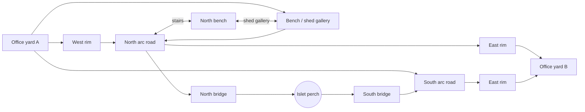

# Greyfold Quarry (loop)

Paper plan of lot 6.13 (written before the build, updated after the bot
trials). The built map is `assets/maps/greyfold-quarry.ron`, authored by
`tools/map-scripts/map_greyfold.py`.

## Sheet

| Item | Value |
|---|---|
| Theme | Working marble quarry under a grey sky (`day` ambience, `overcast` sky, rain after 200 s, `nature` palette, gravel floor) |
| Mode | `fps` team, also playable free-for-all |
| Players | 8 to 16 (8 spawns per team) |
| Archetype | Loop: the haul road circles a flooded pit; an islet with a crane in the pit |
| Size | 100 m x 68 m inside the quarry faces, about 4 100 m2 walkable |
| Symmetry | `Rotate180`: each team has the cutting shed on one arc and the open terraces on the other |
| Engagement | Mid range: 9 to 18 m expected (open floor, benches give height) |

## Layout

```
   x=-50                              x=0                               x=50
 z=-34 ^^^^^^^^^^^^^^^^^^^^^^^ quarry face, 12-16 m ^^^^^^^^^^^^^^^^^^^^^^^^^^
 z=-28 |bench|  CUTTING SHED   |  bench y=3: blocks, health  ....  stairs  |
       |  S  | (hall + gallery)|  S stairs        dump truck       conveyor|
 z=-11 |     |  rim wall  (=======  flooded pit  =======)  bridge          |
       | A   |   west rim  (  [islet: crane perch, armour]  )  east rim  B |
 z=+11 |yard |  bridge  (=======  flooded pit  =======)   rim wall         |
       |     |conveyor  dump truck  stairs     |  CUTTING SHED     |  S    |
 z=+28 |  stairs  .... bench y=3              | (hall + gallery)  |bench  |
 z=+34 vvvvvvvvvvvvvvvvvvvvvvvvvv quarry face vvvvvvvvvvvvvvvvvvvvvvvvvvvvvvv
```

Section through the north arc (left = north):

```
  face 14 m |#|
            |#|  bench y=3 (6 m deep)
            |#|=========|      haul road y=0 (11 m)       |rim wall 1 m| pit, water at -6 m
            |#|         |S  (stairs every 15-20 m)        |            |~~~~~~~~~~~~~~~
```

## Lanes and flow

- **Outer lane:** the benches at y = 3 along the quarry faces, joined through
  the upper floor (gallery) of each cutting shed. Height advantage over the
  road, little cover except cut blocks.
- **Middle lane:** the haul road, the floor of the quarry, around the pit on
  both arcs. Cover: cut marble blocks, dump trucks, conveyor legs.
- **Inner lane:** the pit rim behind a low wall, and the two plank bridges to
  the islet (no railing). The crane perch (2.5 m, railings on two sides)
  sees both arcs.
- **Contested centre:** the islet and its perch; the bridges land on
  opposite arcs, so crossing from one arc to the other through the islet is
  not shorter than going around.



## Interiors, windows, sightlines

- Cutting shed: machine hall on the ground (two wide doors to the road, side
  doors), gallery at the bench level with doors to the bench on both sides
  and windows over the road and the pit. Stairs inside link the two floors.
- Site office in each spawn yard: two floors, windows over the yard.
- The pit is open, so sightlines across it are long (40 m); the crane base,
  the masts and the islet rim walls cut the axis between the two spawn
  yards.

## Spawns

Walled office yard at each end, gates to both arcs and openings to the rim.
The enemy yard is 70 m away across the pit, out of sight behind the crane.

## Pickups and risk/reward

| Pickup | Where | Risk |
|---|---|---|
| Armor | Crane perch on the islet (one) | reached by a bridge without railing, visible from both arcs |
| Health | Shed machine hall, bench near the far end (one per half) | |
| Ammo | West rim and haul road (one per half) | |

## Landmarks

The orange crane on the islet, the two cutting sheds with metal roofs, the
green dump trucks, the conveyor, pines on top of the faces.

## Borders

Quarry faces of 12 to 16 m with stepped tops on every side. Beyond the bounds:
forested hills from the top of the faces (`ground: 14`), slopes east and
west, mountains on the horizon.

## Iterations (bot trials)

1. First build: no wall at the rim. Bots dodging near the edge fell into the
   pit (the trial does not model kill volumes, so they kept fighting at the
   bottom): mean engagement distance 6 m, a quarter of the floor unvisited.
2. Low walls along the pit rim and around the islet (gaps at the bridge
   heads), benches narrowed from 8 to 6 m: engagement about 10 m, dead
   zones about 20 % (mostly the back of the benches and the office
   interiors).

Final figures are in the lot 6.13 report (trial table) and can be rerun with
`tools/map-scripts/trial_table.py`.
