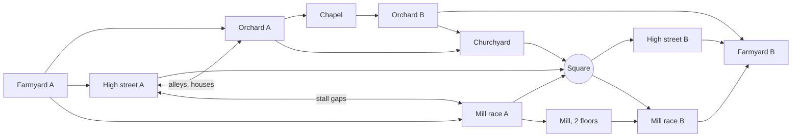

# Mossgate (L-shaped village)

Paper plan of lot 6.13 (written before the build, updated after the bot
trials). The built map is
`assets/maps/mossgate.ron`, authored by `tools/map-scripts/map_mossgate.py`.

## Sheet

| Item | Value |
|---|---|
| Theme | Walled mill village on a pond, rainy autumn afternoon (`storm` ambience, `overcast` sky, rain then clear after 3 minutes, `nature` palette) |
| Mode | `fps` team (two teams), also playable free-for-all |
| Players | 8 to 16 (8 spawns per team) |
| Archetype | L-shape: two arms (one per team) meeting at an elbow; the inside of the L is a mill pond |
| Size | 76 m x 76 m bounding box, about 2 900 m2 walkable |
| Symmetry | Mirror across the vertical plane x = z (swaps the arms and the teams). The format has no diagonal symmetry, so the script writes both halves; vegetation that blocks sight is placed by hand on both sides |
| Engagement | Close to mid range: 8 to 15 m expected |

## Layout

```
          x=-22                 x=10                                  x=54
   z=-22  +----------------------------------------------------------------+
          | CH  |  orchard lane (outer) .  .  oak  .  wall  .  oak  . |barn|
          | apel|  bakery |a| house |a|  INN (2 floors)  |a| shed |a |    |
          |  yd |    SQUARE      | high street (middle)  cross   cart  | A  |
          |     |    (well)      | stalls  wash-house  stalls  crates  |yard|
          |     |          [MILL]| mill race walk (inner) ~ pond wall ~|    |
   z=10   |     |  B arm   +-----+-------------------------------------+----+
          |  (mirror of  | ~~~~~~~~~~~~~~~ mill pond (deadly) ~~~~~~~~~~~~~ |
          |   the A arm) | ~~~~~~~~~~~~~~ islet + boathouse ~~~~~~~~~~~~~~~ |
   z=54   +--------------+--------------------------------------------------+
```

Half-metre grid schema of the elbow (one character = 1 m here for width;
`#` wall, `=` low wall, `D` door, `w` window, `S` stairs, `~` water):

```
   -22                -13      -6                 10      17
    #####################################################
    #  chapel  S S S  D  orchard ......................
    #  (2 fl.)        #  ==D==  #####D#####   ###D####
    #        w        #         # bakery  #   # house
    ####D######w#######  yard   ####D######   ##D#####
    #  orchard                 SQUARE
    #  ......         .          (well)          high street
    #                 .                      ###D###
    #                 .                      # MILL #~~~~~
    #                                       D (2 fl)#~~~~~
```

## Lanes and flow

- **Outer lane (flank, long):** orchard behind the houses, low dry-stone
  walls and oaks. At the outer corner the two orchards meet in the chapel:
  ground floor passage between its two doors, upper floor with windows down
  both orchard lanes. Both orchards open into the square through the
  churchyard.
- **Middle lane:** the high street from each farmyard to the square. A
  market cross and a cart break the long sightline down the street.
- **Inner lane:** the covered mill race walk along the pond wall (windows
  over the water, no open sightline across the pond). It ends in the square
  or goes through the mill.
- **Contested centre:** the square in the elbow, where the three lanes of
  both arms meet. The mill stands in the water at the inner corner: two
  doors from the mill race walks, upper floor with windows over the square
  and the pond.



## Interiors, windows, sightlines

- Multi-floor: chapel (stairs to a gallery), inn (two floors, windows on all
  sides), mill (two floors). Single-floor bakery, house and shed are
  walk-through (doors on the street and on the orchard).
- Windows sit 1.0 m to 2.0 m above the floor: low cover below, a frame to
  shoot through.
- Long sightlines are cut: market cross and cart on the high street, a hay
  wagon behind the farmyard gate, the pond wall closes the view across the
  water (three windows only).

## Spawns

Each team spawns in the farmyard at the end of its arm, behind a stone wall
with two gates (street, mill race) and the barn: no sightline from the street
or the square into the yard. Enemy spawns are more than 70 m apart and never
see each other.

## Pickups and risk/reward

| Pickup | Where | Risk |
|---|---|---|
| Armor | Mill, upper floor (one) | windows on every side, reached by one stair |
| Health | Square (one), chapel ground floor (one), orchard by the cider press and inn ground floor (one per arm) | |
| Ammo | Square by the mill (one), churchyard and wash-house (one per arm) | |

## Landmarks

Chapel with its bell tower (outer corner), the mill with its water wheel
(inner corner), the red barns at the end of each arm, the market cross, the
islet with a ruined boathouse in the pond.

## Borders

Town walls (5 m) on the outer sides, stone walls behind the farms, the pond
on the inside (a `KillVolume` under the water). Beyond the bounds: forest
behind the walls, slopes rising behind the pond, mountains on the horizon.

## Iterations (bot trials)

1. First build: a footbridge crossed the pond from one mill race walk to the
   other, and the mill stood on the land side of the square. Bots fought only
   around the footbridge (the shortest route and an open sightline across
   the pond); about half of the walkable cells were never visited.
2. Footbridge removed, square moved to the inner corner, mill moved into the
   water, pond wall with windows added: fights moved to the square, dead
   zones down to about 35 %.
3. Health pickups moved to the chapel and the orchard near it, walls of the
   border left out of the dead-zone count: dead zones about 18 %.

Final figures are in the lot 6.13 report (trial table) and can be rerun with
`tools/map-scripts/trial_table.py`.
