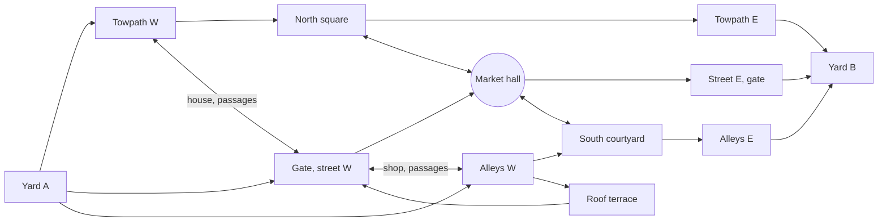

# Nightjar Market (three lanes around a centre)

Paper plan of lot 6.13 (written before the build, updated after the bot
trials). The built map is `assets/maps/nightjar-market.ron`, authored by
`tools/map-scripts/map_nightjar.py`.

## Sheet

| Item | Value |
|---|---|
| Theme | Canal-side market quarter at night, lanterns and lit windows (`night` ambience, `stars` sky, `urban` palette, every light named in `lights`) |
| Mode | `fps` team, also playable free-for-all |
| Players | 8 to 16 (8 spawns per team) |
| Archetype | Three lanes between two spawns, all passing around a covered market hall in the middle |
| Size | 92 m x 40 m of streets, about 3 300 m2 walkable |
| Symmetry | `MirrorX` (mirror across x = 0): the canal lane stays north and the alleys stay south for both teams |
| Engagement | Close quarters: 6 to 12 m expected |

## Layout

```
   x=-48                              x=0                                x=48
 z=-38 ######### warehouses on the far bank (scenery, lit windows) ###########
 z=-30 ~~~~~~~~~~~~~~~~~~~~~~~~~~ canal (deadly) ~~~~~~~~~~~~~~~~~~~~~~~~~~~~~
 z=-22 |blk| towpath: bollards, crates, nets  | north square |  towpath  |blk|
 z=-14 |   | HOUSE 2fl |p| SHOP |p|           +---D----D---+  ...       |   |
 z=-4  |A  GATE  street   kiosk   ==arcade==  | MARKET HALL | ==arcade==   B|
 z=+4  |yd | HOUSE |p| SHOP + ROOF TERRACE |p| (gallery 2fl)|  ...       |yd |
 z=+12 |blk| alleys: arch, crates, stairs up  +---D----D---+  alleys    |blk|
 z=+18 |   |      courtyards                  south courtyard           |   |
 z=+26 ######### tall houses (border, lit windows and doors) #################
```

(`p` = 3 m passage between the rows, `D` = door, `yd` = spawn yard.)

Hall, ground floor and gallery (one half, the other is its mirror):

```
  z=-10 #####D####|####D#####      gallery (y = 4): windows on all four sides,
        #S S S S S|                stairs along the north wall,
        #  stalls |                armour in the middle of the south part
  street  arcade  [lantern stand]  arcade (6 m wide, 3.5 m high)
        #  stalls |
  z=+10 #####D####|####D#####
```

## Lanes and flow

- **North lane (long sightlines):** the towpath along the canal, 8 m wide,
  bollards and crates as low cover; the canal is deadly. Opens onto the
  north square in front of the hall.
- **Middle lane:** the market street from the lantern gate of each yard to
  the hall arcades; a kiosk halfway and the lantern stand inside the hall
  break the 70 m axis.
- **South lane (close quarters):** narrow alleys and courtyards, an arch,
  crates; stairs up to the roof terrace of the long shop, which overlooks
  both the street and the alleys.
- **Centre:** the market hall: arcades on the street, doors to the north
  square and the south courtyard, gallery above with windows on every side.
- **Cross links:** passages between the houses and walk-through shops join
  the lanes every 10 to 15 m.



## Interiors, windows, sightlines

- Multi-floor: market hall (gallery), north house (two floors, windows on
  both streets), roof terrace of the long shop (stairs from the alley).
- Windows at 1.0 to 2.0 m above each floor; the hall gallery windows cover
  the north square, the street and the south courtyard.

## Spawns

Each team spawns in a walled yard behind a lantern gate: three exits
(towpath, street through the gate, alleys), no sightline from the hall into
the yard (the lantern stand and the kiosks block the street axis).

## Pickups and risk/reward

| Pickup | Where | Risk |
|---|---|---|
| Armor | Hall gallery (one) | windows on every side, stairs on one side only |
| Health | North square (one), north house ground floor and alleys (one per half) | |
| Ammo | South courtyard (one), towpath and roof terrace (one per half) | the terrace is exposed to the street |

## Landmarks

The market hall with its lit cupola, the red lantern gates, the canal and
the warehouses on the far bank, the teal kiosk roofs.

## Borders

The canal (a `KillVolume` under the water) and the warehouses beyond it on
the north side, rows of tall houses on the south side, blocks of houses at
the ends. Beyond the bounds: the sea behind the warehouses, a slope behind
the south houses, forest at the ends.

## Iterations (bot trials)

1. First build: fights evenly balanced, but the towpath end near each yard
   was rarely visited (the street is the shortest way out of the yard).
2. The health pickup of each half moved from the north house to the
   towpath and the ammo to the house upper floor: bots heading for health
   use the towpath. The trial counts cells inside the streets only (the
   canal edge and the border houses are left out).

Final figures are in the lot 6.13 report (trial table) and can be rerun with
`tools/map-scripts/trial_table.py`.
